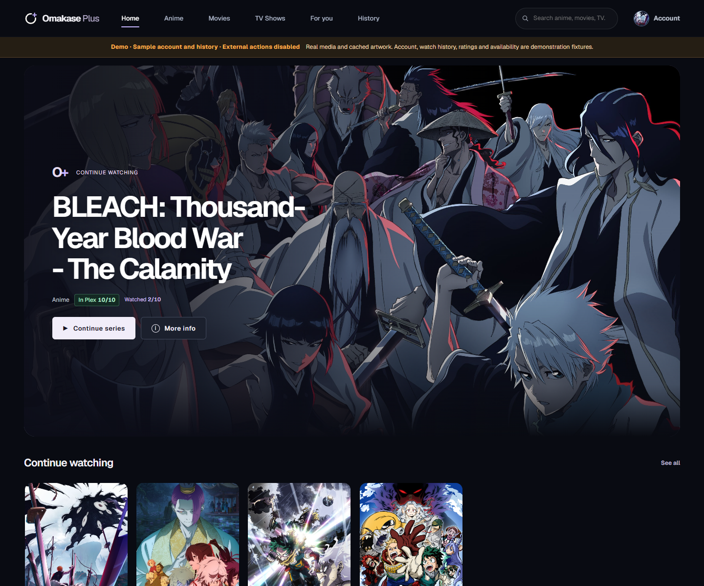
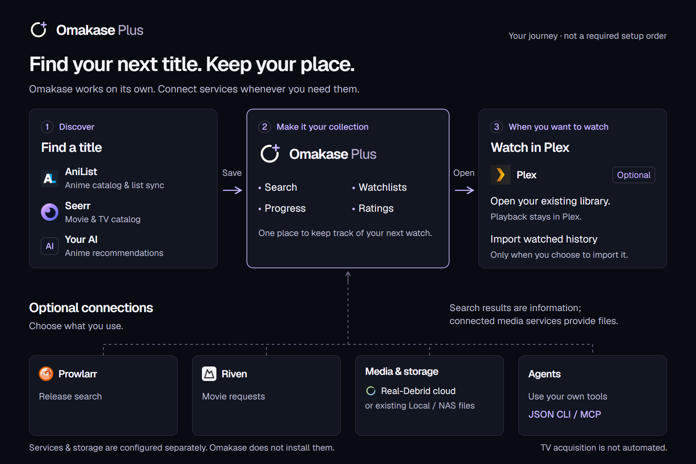

# Omakase Plus

Your anime, movies and TV, organized for the next watch.

A self-hosted application for discovery, planning, viewing progress, ratings and
connected library availability. Start with one app, then connect services you use.

**Early release · Self-hosted · MIT software.**
[Source](https://github.com/JhinxDev/omakase-plus) ·
[Quickstart](https://omakase-plus.jhinx.dev/docs/quickstart) ·
[Documentation](https://omakase-plus.jhinx.dev/docs)

Run your own authenticated instance and connect only the services you need.
There is no hosted signup or bundled media.



*Actual interface; sample account, ratings, progress and availability. External
actions are disabled in the [local showcase](docs/showcase.md). Artwork and vendor
branding retain their owners' rights; see [third-party notices](THIRD-PARTY-NOTICES.md).*

## What works

- Anime search, recommendations, planning and progress, with optional AniList sync.
- Movie discovery and requests through configured services, explicit Plex history
  import and personal ratings.
- TV season browsing, exact-ID Plex inventory and manual episode progress.
- Managed anime media checks and Plex publication, with protected shared/adopted
  assets and separately confirmed removal.
- Account-specific [notifications](docs/notification-center.md) to rate finished titles
  and review safely owned anime media, with read/dismiss controls.
- Account-scoped JSON CLI and optional stdio MCP access, with named permissions
  and an audit log. See [agent tools](docs/agent-tools.md).

Availability, watch progress, requests and media verification remain independent.
Catalog metadata does not prove a file can play. TV acquisition is not automated;
Apple TV progress is manual. No media, provider account or API key is included.

## Start with the app

Want Claude Code or Codex to handle host setup? [Copy one setup prompt](docs/setup-with-an-agent.md). It checks your existing installation, starts with the app alone and keeps secrets on your computer.

Clone the repository:

```sh
git clone https://github.com/JhinxDev/omakase-plus.git
cd omakase-plus
cp .env.local.example .env.local
cp .env.local.secrets.example .env.local.secrets
chmod 0600 .env.local.secrets
```

Use Git, Python 3, and Docker Engine with the Compose plugin on a Linux host. Set your app-data
directory and UID/GID in `.env.local`, and generate a master encryption key using
the [getting-started guide](docs/getting-started.md). Keep secrets in
`.env.local.secrets`, outside version control. Then:

```sh
docker compose --env-file .env.local -f compose.standalone.yaml config --quiet
docker compose --env-file .env.local -f compose.standalone.yaml build omakase-plus
docker compose --env-file .env.local -f compose.standalone.yaml up -d
docker inspect omakase-local-app --format '{{.State.Health.Status}}'
```

Open [http://127.0.0.1:8766/plus](http://127.0.0.1:8766/plus) on that host, create
your account, and follow Choose → Connect → Review → Enjoy. On a remote host,
use an administrator-configured secure tunnel or protected HTTPS proxy; its
loopback is not the browser computer's loopback.

`OMAKASE_PLUS_PRIVATE=true` enables the authenticated application. It describes
deployment access, not source-code visibility. Keep authentication and private
network defaults when deploying this public source.

## Choose your setup



Start with personal planning, then add the connections you use. Movie and TV catalog search requires Seerr; playback stays in optional Plex.

| Setup | Start here | Separate administrator work |
| --- | --- | --- |
| Omakase only | `compose.standalone.yaml` | None of the media services are required |
| Existing services | [Connections and media](docs/media-library-and-connections.md) | Configure your own service addresses and credentials |
| Local import or optional Plex | [Storage and Plex](docs/local-storage-plex-setup.md) | Explicit mounts, permissions and Plex account/library setup |

Onboarding saves preferences and guidance; it does not install services or change
host mounts. Optional qBittorrent acquisition remains scoped to its VPN profile.
Use only media and services you are authorized to access.

## Optional shared libraries, languages and personal tracker sync

**Released optional capabilities.** Shared libraries, language settings and personal
tracker reconciliation are included in the release. New-install feature flags
default off. Each installation needs operator qualification of combined migrations
033–036, rollback and its configured adapters before opt-in activation. A saved
preference or passing unit test is not proof of working provider connections.

| Optional feature | What stays separate |
| --- | --- |
| [Households](docs/households.md) | Shared catalog/files; each member's progress, ratings, tracker accounts and stream choices |
| [Audio and subtitles](docs/language-settings.md) | Requested languages, physically verified tracks and the viewer's current Plex selection |
| [MyAnimeList ↔ AniList](docs/myanimelist-bridge.md) | Each user's verified identities; first-sync preview, conflict decisions and opt-in ongoing checks |

An owner connector never grants members its credentials. Revocation stops future
access and work without erasing personal history. Language choices never replace
someone else's working copy. Tracker connections require administrator OAuth setup
and each user's own consent; no account is connected by this repository.

## Development and operation

Python 3.11+ and `uv` are required for source development:

```sh
uv sync --frozen --extra dev
uv run --frozen --extra dev python -m pytest
uv run --frozen --extra dev python -m ruff check .
uv run --frozen --extra dev python -m ruff format --check .
uv run --frozen omakase --help
```

Read [Contributing](CONTRIBUTING.md), [Security](SECURITY.md),
[release checks](docs/release-checklist.md), [updates](docs/updates.md), and
[optional browser QA](docs/browser-qa.md). The recommendation-only CLI/web
surface remains available; it is distinct from the authenticated Plus app.

The code retains its original [MIT license](LICENSE) and upstream attribution.
Geist retains its [SIL Open Font License](src/omakase/plus/static/GEIST-OFL.txt).
Source tests do not establish native deployment, full playback, physical-device
or human creative acceptance.
