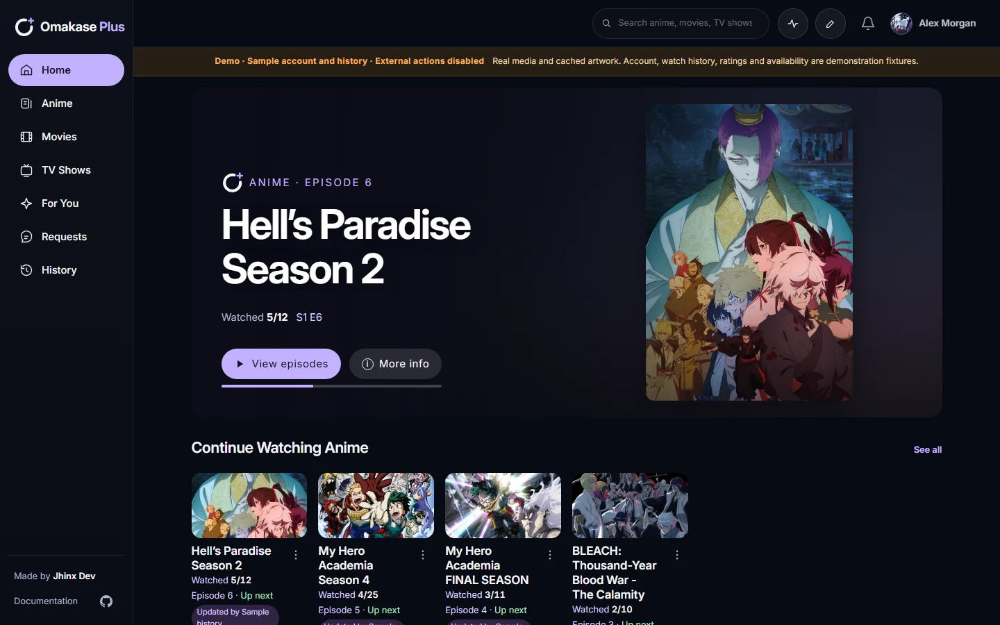

# Omakase Plus

**Find what to watch next. Pick up where you left off.**

Omakase Plus is a self-hosted app for anime, movies and TV. Discover titles,
organize your watchlist and play eligible media in your browser or on Apple TV.
Your progress, ratings and connections stay on your server.

[Quickstart](https://omakase-plus.jhinx.dev/docs/quickstart) ·
[Documentation](https://omakase-plus.jhinx.dev/docs) ·
[Latest release](https://github.com/JhinxDev/omakase-plus/releases/latest)



*Single-window capture from the demo app with a sample account and watch history. See the [artwork notices](THIRD-PARTY-NOTICES.md).*

## Releases

**[0.4.12](https://github.com/JhinxDev/omakase-plus/releases/tag/v0.4.12)** is the
latest numbered source release. It adds Apple TV watch tracking for movies and
TV episodes and improves seeking on matched Real-Debrid HEVC files. Large HEVC
TV files can use the native Apple TV HLS path. Back up your app data before
upgrading. See the [changelog](CHANGELOG.md) for earlier releases.

The [November 15 web build](https://github.com/JhinxDev/omakase-plus/tree/web-26619cc3cd85)
is a separate source snapshot with a browser player that fits beneath the header,
fullscreen controls that stay visible, and clearer playback errors. That snapshot
also includes opt-in request search from the
[preceding web build](https://github.com/JhinxDev/omakase-plus/tree/web-abb4641eaa58).
For the setup below, use the numbered release.

## What you can do

- **Discover and organize.** Find anime with AniList, search movie and TV catalogs
  with Seerr, and keep watchlists, ratings and recommendations in one place.
- **Watch and resume.** Play a matched copy from Real-Debrid or an eligible Plex
  library copy. Use browser playback or pair the [native Apple TV app](docs/apple-tv.md).
  The media and player determine which tracks are available.
- **Follow availability.** Request movies through your configured stack and see
  which titles are available. Watch history stays separate from library status.
- **Connect when you need to.** Add services for shared libraries, language
  preferences, tracker sync or the account-scoped CLI and MCP tools.

## Choose your setup

| Start with | What you can do |
| --- | --- |
| **Omakase Plus alone** | Search anime and manage your watchlist, progress and ratings. |
| **Omakase Plus + Real-Debrid** | Play matched anime, movies and TV in your browser or on Apple TV. No Plex server or NAS required. |
| **Omakase Plus + Plex** | Connect your library, check exact copies, import viewing history and play through Plex or the optional browser player. |
| **Add Seerr** | Search movie and TV catalogs and request movies through your configured services. |

In **Settings → Connections**, choose **Real-Debrid only**, **Plex only** or
**Auto**. Auto prefers a matched Real-Debrid copy and can fall back to Plex.
[Pick a setup](https://omakase-plus.jhinx.dev/docs/setup-choices) ·
[Browser player](docs/web-player.md) ·
[Real-Debrid playback](docs/real-debrid.md) ·
[Pair Apple TV](docs/apple-tv.md)

## Run it yourself

Use Git, Python 3 and Docker Engine with the Compose plugin on a Linux host.
Follow the [getting-started guide](docs/getting-started.md) to set your app-data
directory, UID/GID and master encryption key. An
[agent-assisted setup](docs/setup-with-an-agent.md) is also available.

```sh
git clone --branch v0.4.12 --single-branch https://github.com/JhinxDev/omakase-plus.git
cd omakase-plus
cp .env.local.example .env.local
cp .env.local.secrets.example .env.local.secrets
chmod 0600 .env.local.secrets
```

After editing those local files, start the app.

```sh
docker compose --env-file .env.local -f compose.standalone.yaml config --quiet
docker compose --env-file .env.local -f compose.standalone.yaml up -d --build
```

Open [127.0.0.1:8766/plus](http://127.0.0.1:8766/plus) on that host and create
the first account. For a remote host, use a protected HTTPS proxy or tunnel.
Keep your secrets outside Git. Additional accounts require an invite from the
instance administrator.

This early release runs on your own server and uses your own accounts and media.
TV acquisition remains manual.

## Further reading

[Households](docs/households.md) ·
[Audio and subtitle preferences](docs/language-settings.md) ·
[Tracker sync](docs/myanimelist-bridge.md) ·
[Agent tools](docs/agent-tools.md) ·
[Changelog](CHANGELOG.md)

[Contributing](CONTRIBUTING.md) ·
[Security](SECURITY.md) ·
[License](LICENSE) ·
[Third-party notices](THIRD-PARTY-NOTICES.md)
