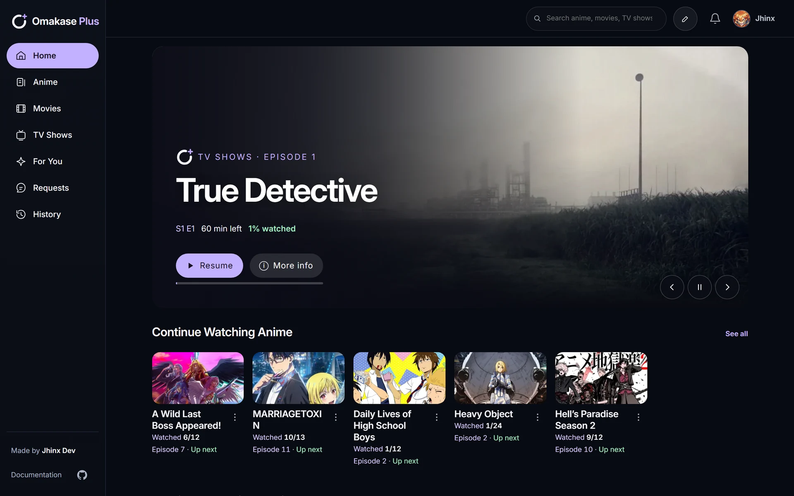
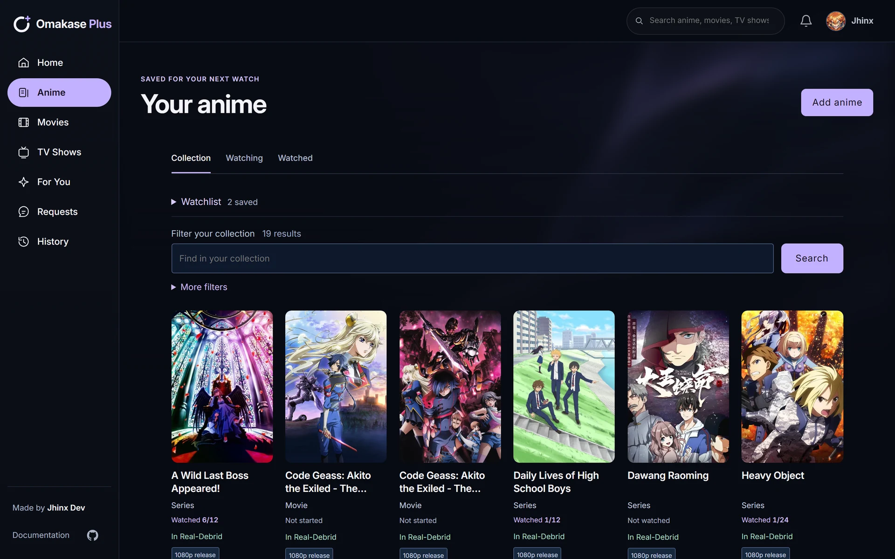
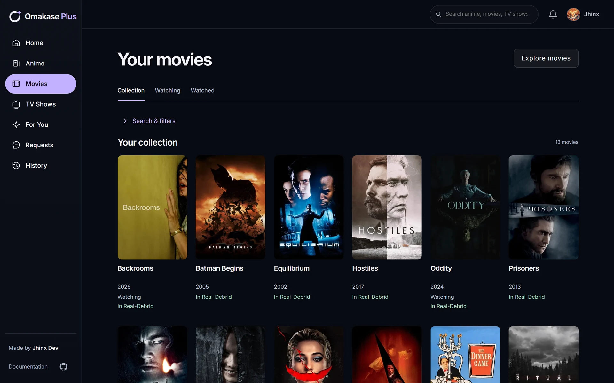
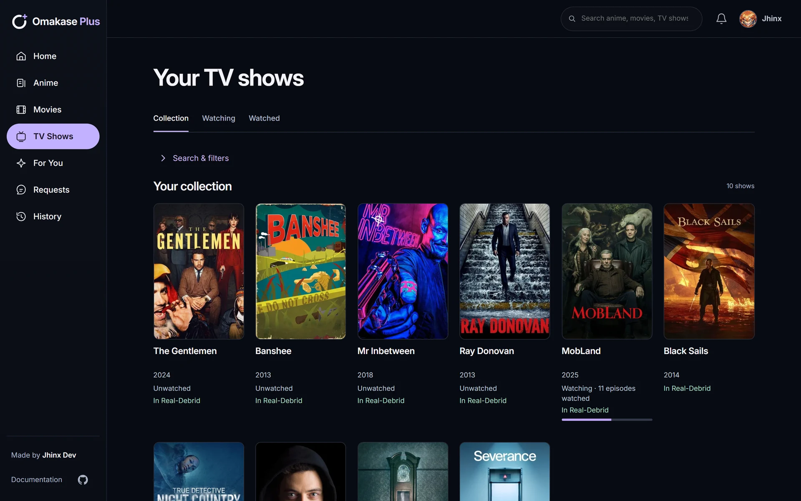
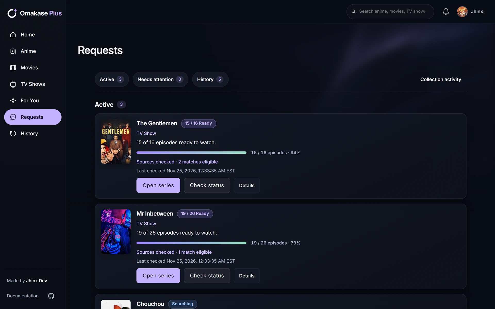
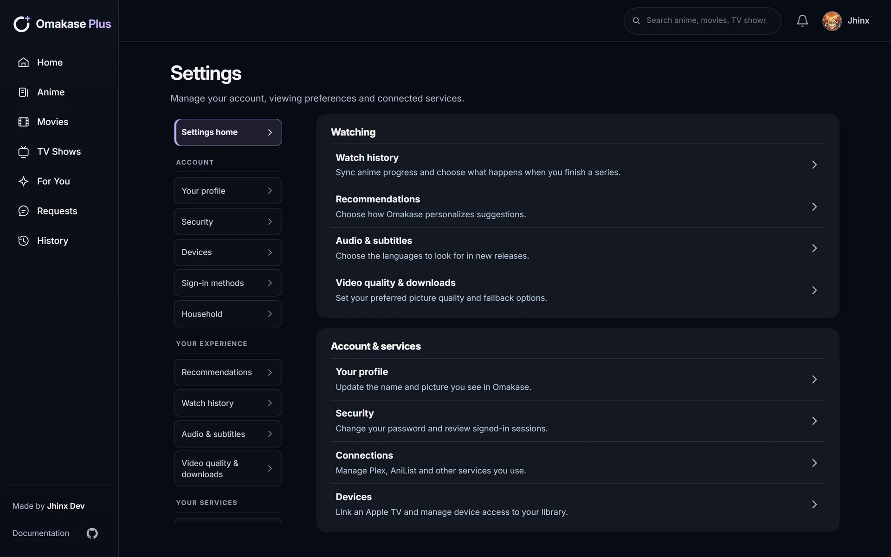
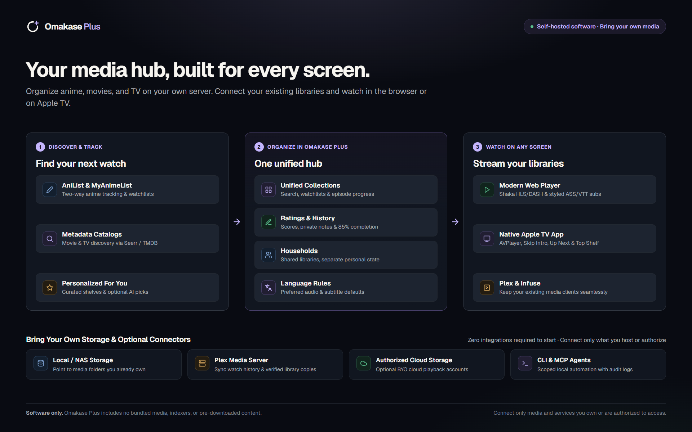

# Omakase Plus

[](https://github.com/JhinxDev/omakase-plus/actions/workflows/ci.yml)
[](https://github.com/JhinxDev/omakase-plus/actions/workflows/docker-publish.yml)
[](LICENSE)
[](https://www.python.org/)

Your anime, movies, and TV, organized in one private media hub.

Omakase Plus is self-hosted personal media management, discovery, tracking, and playback software for the browser, Apple TV, and iPhone. Like Plex, it operates strictly on a **Bring Your Own Media (BYOM)** model: Omakase Plus provides the software alone, includes zero bundled or pre-downloaded media, and connects only to libraries, storage, and accounts that you own or are authorized to access.

**Early release · Self-hosted · MIT software.**  
[Video Walkthrough](https://youtu.be/_6rfTJXNMVs) · [Documentation](https://omakase-plus.jhinx.dev/docs) · [Quickstart](https://omakase-plus.jhinx.dev/docs/quickstart) · [Changelog](CHANGELOG.md) · [Apple TV App](docs/apple-tv.md) · [Security](SECURITY.md)



*Single-viewport captures from a live Omakase Plus server with private account and connection details redacted. Artwork and vendor branding belong to their respective owners; see [THIRD-PARTY-NOTICES.md](THIRD-PARTY-NOTICES.md).*

## Video walkthrough

[](https://youtu.be/_6rfTJXNMVs)

Watch the full 8-minute dev update and setup walkthrough on YouTube: [Tired of Streaming Subscriptions? I Built a Free All-in-One Media Hub](https://youtu.be/_6rfTJXNMVs) (covering standalone setup, AniList & MyAnimeList tracking, Plex/Real-Debrid/local connections, HLS playback, native Apple TV & iPhone TestFlight pairing, and the 2-minute Docker quickstart).

## Releases

The quickstart uses [v0.5.0](https://github.com/JhinxDev/omakase-plus/releases/tag/v0.5.0), the latest numbered source release, alongside prebuilt container images at `ghcr.io/jhinxdev/omakase-plus` (`:latest`, `:0.5.0`, and `:0.5`). See the [changelog](CHANGELOG.md) for full release history. Back up your app data and encryption key before upgrading.

## Interface tour

| Anime Collection | Movies |
| --- | --- |
|  |  |
| **TV Shows** | **Requests** |
|  |  |

### Settings Directory



## What works

- **Unified discovery & watchlists:** Organize anime, movies, and TV in one personal hub with optional two-way AniList and MyAnimeList tracking, Seerr/TMDB catalog search, **For You** shelves, private review notes, and customizable Home rows (**Edit Home**).
- **Modern web player:** Stream eligible libraries in the browser via Shaka Player with HLS and DASH playback, non-reloading unbuffered VOD seeking, styled ASS/SSA (JASSUB WebAssembly) and WebVTT subtitle switching, playback speed controls, 85% completion tracking, and cross-device resume. See [Web player](docs/web-player.md).
- **Native Apple TV app (`tvOS`):** Native AVPlayer client (`tv-source/`) with one-time PIN pairing, Home Screen Top Shelf Continue Watching, **Skip Intro** on verified opening markers, 10-second **Up Next** auto-play countdown, **Media Info** inspector, Audio/Subtitle language pickers, and automated Internal TestFlight cloud signing via GitHub Actions. See [Apple TV](docs/apple-tv.md).
- **Native iPhone app (`iOS V1`):** Native SwiftUI client (`ios-source/`) sharing `QualificationCore` with Apple TV for pairing codes, invitation links, household profile switching, Home shelves, library browsing, catalog search and requests, native `AVPlayerViewController` (PiP, AirPlay, Skip Intro, Next Episode, Media Info), and GitHub Actions TestFlight Cloud Signing. *(Both the Apple TV and iPhone apps are currently distributed via TestFlight rather than public App Store listings yet.)*
- **Households & language rules:** Share library visibility safely while keeping each member's progress, ratings, tracker accounts, and stream choices separate. Enforce personal audio and subtitle preferences across eligible releases. See [Households](docs/households.md) and [Audio & subtitles](docs/language-settings.md).
- **Scoped operator automation:** Account-scoped JSON CLI and optional stdio MCP access with explicit write grants and an audit log, plus [notifications](docs/notification-center.md) for rating finished titles or reviewing managed copies. See [Agent tools](docs/agent-tools.md).

## How it works



Start with personal planning on one container, then connect only the storage and services you use:

| Setup path | Start here | What you bring |
| --- | --- | --- |
| App only | `compose.standalone.yaml` | Your own server, personal watchlists, and optional AniList sync |
| Existing Plex or local storage | [Local Storage + Plex](docs/local-storage-plex-setup.md) | Your existing media directories, host mounts, and Plex library |
| Authorized cloud storage (BYO) | [Media connections](docs/media-library-and-connections.md) · [Real-Debrid guide](docs/real-debrid.md) | Your own authorized cloud storage account and credentials |
| Apple TV companion | [Apple TV guide](docs/apple-tv.md) | Your Xcode/App Store Connect team for TestFlight or local builds |

## Start with the app

The fastest way to try Omakase Plus on any Linux host or homelab server with Docker Engine is the interactive quick installer, which pulls the prebuilt `ghcr.io/jhinxdev/omakase-plus:latest` image, generates your private encryption key automatically, and writes a clean `compose.yaml`:

```sh
curl -fsSL https://omakase-plus.jhinx.dev/install.sh | bash
```

Want Claude Code or Codex to inspect an existing host instead? [Copy the setup prompt](docs/setup-with-an-agent.md). It inspects existing containers first, starts cleanly with app-only mode, and keeps all credentials on your machine.

Prefer manual source setup? Clone the repository and configure your local environment:

```sh
git clone --branch v0.5.0 --single-branch https://github.com/JhinxDev/omakase-plus.git
cd omakase-plus
cp .env.local.example .env.local
cp .env.local.secrets.example .env.local.secrets
chmod 0600 .env.local.secrets
```

On a Linux host with Git, Python 3, and Docker Compose: set `OMAKASE_DATA_PATH` and your UID/GID in `.env.local`, generate `OMAKASE_PLUS_MASTER_KEY` per the [getting-started guide](docs/getting-started.md), keep secrets in `.env.local.secrets`, and start the app:

```sh
docker compose --env-file .env.local -f compose.standalone.yaml config --quiet
docker compose --env-file .env.local -f compose.standalone.yaml build omakase-plus
docker compose --env-file .env.local -f compose.standalone.yaml up -d
docker inspect omakase-local-app --format '{{.State.Health.Status}}'
```

Open [http://127.0.0.1:8766/plus](http://127.0.0.1:8766/plus) on that host, create your administrator account, and follow **Choose → Connect → Review → Enjoy**. For remote access, place it behind your own authenticated HTTPS reverse proxy or private tunnel.

`OMAKASE_PLUS_PRIVATE=true` activates the authenticated hub: `/` redirects into `/plus`, public BYOK `/api/*` endpoints stay off, and `/docs` redirects to the documentation site. Registration locks automatically after the first account until an administrator issues `OMAKASE_PLUS_INVITE`.

## Optional shared libraries, languages & tracker sync

New installations ship with optional shared libraries (`households`), automated language enforcement, and ongoing MyAnimeList tracker reconciliation disabled by default. Operators should review database migrations, backups, and configured adapters before enabling them per instance. See [Households](docs/households.md), [Audio & subtitles](docs/language-settings.md), and [MyAnimeList bridge](docs/myanimelist-bridge.md).

## Bring Your Own Media & legal notice

Omakase Plus distributes **software only**.

- The repository and container images contain **zero media files, indexers, trackers, scrapers, or pre-downloaded content**.
- Optional self-hosted connectors (including Plex, local mounts, Seerr, AniList, MyAnimeList, and BYO cloud storage) remain unconfigured and inactive unless you explicitly connect your own accounts or infrastructure.
- You are solely responsible for supplying your own legally owned or authorized media, respecting provider terms of service, and complying with applicable laws in your jurisdiction.

## Development & licensing

Python 3.11+ and `uv` are used for local development and verification:

```sh
uv sync --frozen --extra dev
uv run --frozen --extra dev python -m pytest
uv run --frozen --extra dev python -m ruff check .
uv run --frozen --extra dev python -m ruff format --check .
uv run --frozen omakase --help
```

- [Contributing](CONTRIBUTING.md) · [Security](SECURITY.md) · [Release checks](docs/release-checklist.md) · [Updates](docs/updates.md) · [Browser QA](docs/browser-qa.md)
- Source code: [MIT License](LICENSE)
- Bundled Geist typography: [SIL Open Font License](src/omakase/plus/static/GEIST-OFL.txt)
- Third-party libraries and notices: [THIRD-PARTY-NOTICES.md](THIRD-PARTY-NOTICES.md) and [JASSUB notices](THIRD-PARTY/jassub-2.5.23/README.md)
- Apple TV (`tv-source/`) and iPhone (`ios-source/`) apps are currently in TestFlight (not yet official public App Store releases) and share the API contracts in this repository. Automated tests do not substitute for physical-device or subjective media playback verification.
