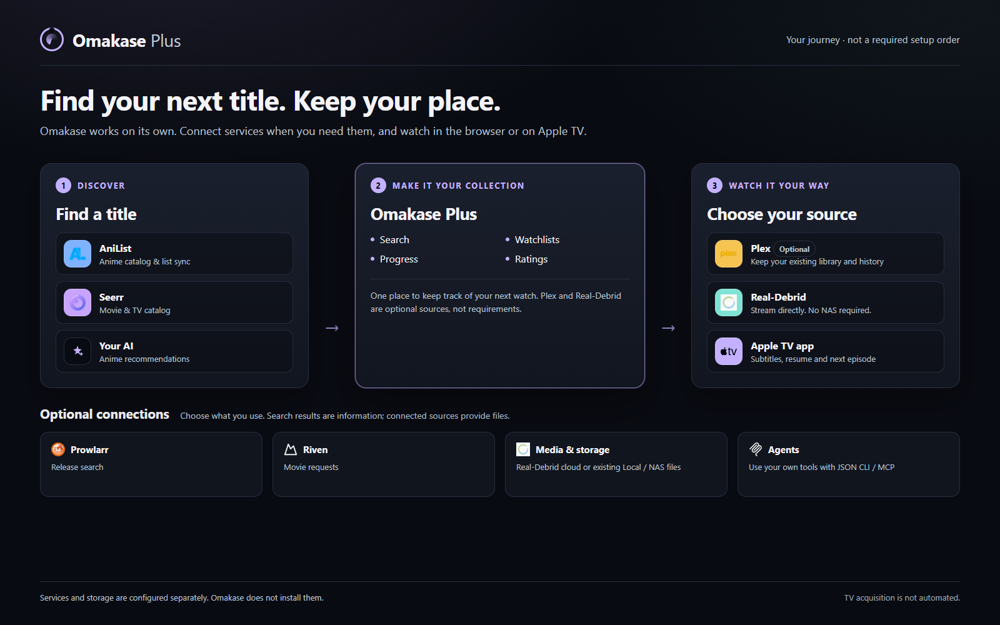

# Omakase Plus

Your anime, movies and TV, organized for the next watch.

A self-hosted application for discovery, planning, viewing progress, ratings and
connected library availability. Watch in the browser or on a native Apple TV
app, from your own Plex server or directly from a Real-Debrid account. Start
with one app, then connect only the services you use.

**Early release · Self-hosted · MIT software.**
[Source](https://github.com/JhinxDev/omakase-plus) ·
[Quickstart](https://omakase-plus.jhinx.dev/docs/quickstart) ·
[Documentation](https://omakase-plus.jhinx.dev/docs)

Run your own authenticated instance and connect only the services you need.
There is no hosted signup or bundled media.


*Single-window capture from the demo app with a sample account, ratings, progress
and availability. External actions are disabled in the
[local showcase](docs/showcase.md). Artwork and vendor branding retain their
owners' rights; see [third-party notices](THIRD-PARTY-NOTICES.md).*

## Releases

The setup below uses [0.4.12](https://github.com/JhinxDev/omakase-plus/releases/tag/v0.4.12),
the latest numbered source release. The [changelog](CHANGELOG.md) lists newer
web and tvOS features under **Unreleased**. They may require a newer server or
native build. Back up app data before upgrading.

## What works

- Discover anime, movies and TV with optional AniList sync and Seerr catalog search.
- Use **Edit Home** to choose your rows. Continue Watching remembers your place
  across the web and paired Apple TV.
- Browse media from connected sources in Collection. Find completed titles,
  ratings and private review notes in your personal viewing history.
- Follow requests submitted by you or on your behalf. TV requests can show
  playable episode counts by season and activity from configured services.
  See [TV requests and episodes](docs/television.md).
- Stream exact Real-Debrid or Plex matches. The Apple TV app supports device
  pairing, subtitles, resume sync, next episode and Media Info for supported copies.
  See [Real-Debrid playback](docs/real-debrid.md) and [Apple TV](docs/apple-tv.md).
- Get [notifications](docs/notification-center.md) to rate finished titles or
  review eligible managed media. Shared or externally managed copies stay protected.
- Account-scoped JSON CLI and optional stdio MCP access, with named permissions
  and an audit log. See [agent tools](docs/agent-tools.md).

Catalog matches, provider decisions, playable files and watch progress have
distinct statuses. Supply your own media and service credentials.

## Start with the app

Want Claude Code or Codex to handle host setup? [Copy one setup prompt](docs/setup-with-an-agent.md). It checks your existing installation, starts with the app alone and keeps secrets on your computer.

Clone the repository:

```sh
git clone --branch v0.4.12 --single-branch https://github.com/JhinxDev/omakase-plus.git
cd omakase-plus
cp .env.local.example .env.local
cp .env.local.secrets.example .env.local.secrets
chmod 0600 .env.local.secrets
```

Use Git, Python 3, and Docker Engine with the Compose plugin on a Linux host. Set your app-data
directory and UID/GID in `.env.local`, and generate a master encryption key using
the [getting-started guide](docs/getting-started.md). Keep secrets in
`.env.local.secrets`, outside version control. Then:

```sh
docker compose --env-file .env.local -f compose.standalone.yaml config --quiet
docker compose --env-file .env.local -f compose.standalone.yaml build omakase-plus
docker compose --env-file .env.local -f compose.standalone.yaml up -d
docker inspect omakase-local-app --format '{{.State.Health.Status}}'
```

Open [http://127.0.0.1:8766/plus](http://127.0.0.1:8766/plus) on that host, create
your account, and follow Choose → Connect → Review → Enjoy. On a remote host,
use an administrator-configured secure tunnel or protected HTTPS proxy; its
loopback is not the browser computer's loopback.

The first account bootstraps a private instance. Account creation is then closed
until an administrator sets `OMAKASE_PLUS_INVITE` for additional people.

`OMAKASE_PLUS_PRIVATE=true` enables the authenticated application. It describes
deployment access, not source-code visibility. Keep authentication and private
network defaults when deploying this public source. A private instance serves
only the authenticated product: `/` redirects into `/plus`, the public BYOK
`/api/*` endpoints are not part of that origin, and `/docs` redirects to the
documentation site. Neither mode serves `/openapi.json`, `/redoc` or an API
console on the app origin.

## Choose your setup



*Third-party names and logos belong to their owners; see [third-party notices](THIRD-PARTY-NOTICES.md).*

Start with personal planning, then add the connections you use. Movie and TV catalog search requires Seerr. Playback can use your existing Plex library, stream directly from Real-Debrid, or play on the native Apple TV app.

| Setup | Start here | Separate administrator work |
| --- | --- | --- |
| Omakase only | `compose.standalone.yaml` | None of the media services are required |
| Real-Debrid only | Connect a token in **Settings → Connections** and choose the Real-Debrid playback source | No Plex server or NAS required |
| Existing services | [Connections and media](docs/media-library-and-connections.md) | Configure your own service addresses and credentials |
| Local import or optional Plex | [Storage and Plex](docs/local-storage-plex-setup.md) | Explicit mounts, permissions and Plex account/library setup |

Onboarding saves preferences and guidance; it does not install services or change
host mounts. Optional qBittorrent acquisition remains scoped to its VPN profile.
Use only media and services you are authorized to access.

## Optional shared libraries, languages and personal tracker sync

**Released optional capabilities.** Shared libraries, language settings and personal
tracker reconciliation are included in the release. New-install feature flags
default off. Each installation needs operator qualification of combined migrations
033–036, rollback and its configured adapters before opt-in activation. A saved
preference or passing unit test is not proof of working provider connections.

| Optional feature | What stays separate |
| --- | --- |
| [Households](docs/households.md) | Shared catalog/files; each member's progress, ratings, tracker accounts and stream choices |
| [Audio and subtitles](docs/language-settings.md) | Requested languages, physically verified tracks and the viewer's current Plex selection |
| [Optional web player](docs/web-player.md) | Exact anime playback, prepared MKV, personal resume and truthful viewing coverage |
| [MyAnimeList ↔ AniList](docs/myanimelist-bridge.md) | Each user's verified identities; first-sync preview, conflict decisions and opt-in ongoing checks |

An owner connector never grants members its credentials. Revocation stops future
access and work without erasing personal history. Language choices never replace
someone else's working copy. Tracker connections require administrator OAuth setup
and each user's own consent; no account is connected by this repository.

## Development and operation

Python 3.11+ and `uv` are required for source development:

```sh
uv sync --frozen --extra dev
uv run --frozen --extra dev python -m pytest
uv run --frozen --extra dev python -m ruff check .
uv run --frozen --extra dev python -m ruff format --check .
uv run --frozen omakase --help
```

Read [Contributing](CONTRIBUTING.md), [Security](SECURITY.md),
[release checks](docs/release-checklist.md), [updates](docs/updates.md), and
[optional browser QA](docs/browser-qa.md). The recommendation-only CLI/web
surface remains available; it is distinct from the authenticated Plus app.

The web app and native Apple TV source share this repository. The native build
and signing instructions are in the [Apple TV guide](docs/apple-tv.md).

The code retains its original [MIT license](LICENSE) and upstream attribution.
Geist retains its [SIL Open Font License](src/omakase/plus/static/GEIST-OFL.txt).
Bundled player dependencies retain their separate licenses, notices and source/
relink materials under [THIRD-PARTY](THIRD-PARTY/jassub-2.5.23/README.md).
Source tests do not establish native deployment, full playback, physical-device
or human creative acceptance.
